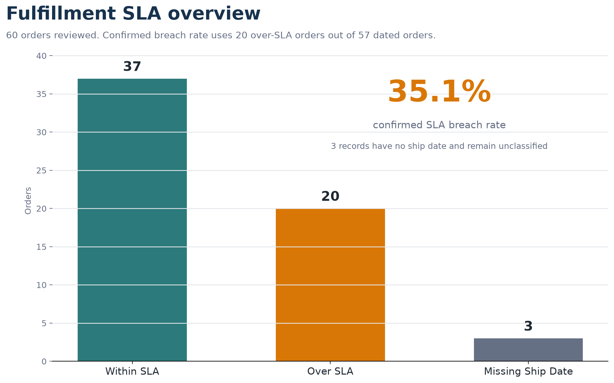
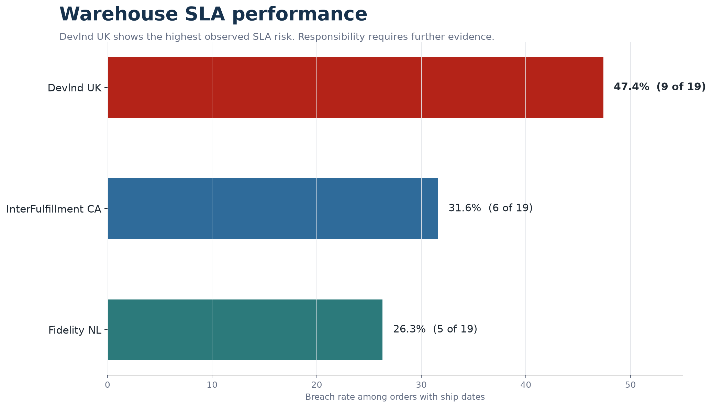
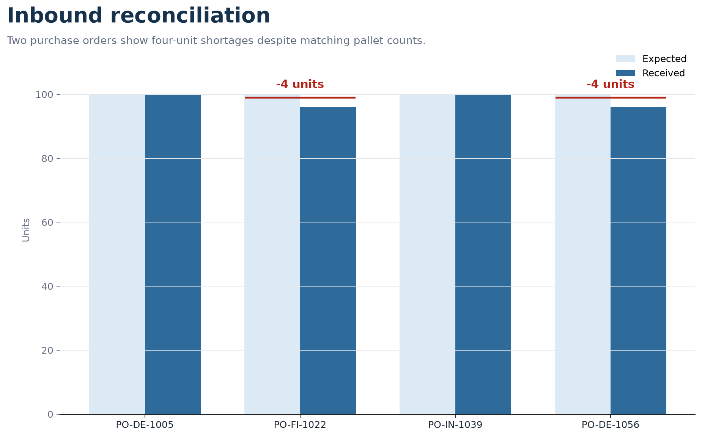
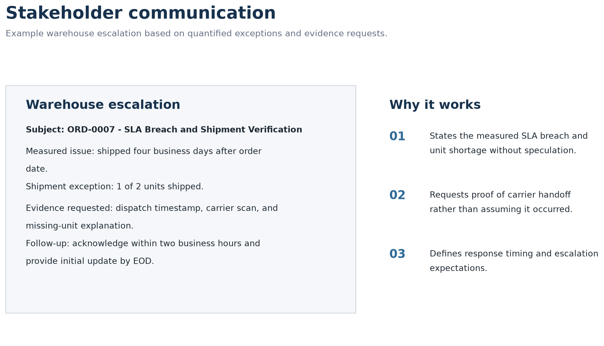
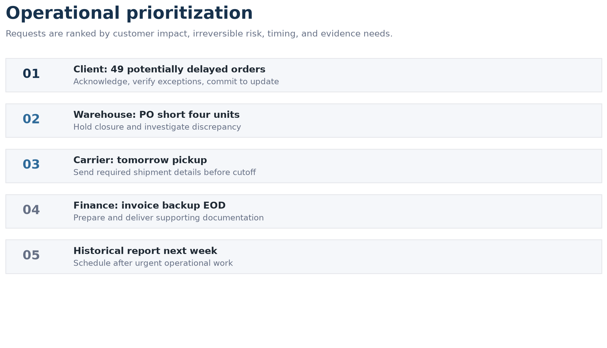

# International Fulfillment & Inbound Reconciliation

**An Operations Analytics Case Study in SLA Monitoring, Inventory Reconciliation, and Exception Management**

Operational performance depends on more than moving orders through a fulfillment network. Teams need reliable shipment data, measurable service-level performance, accurate inventory records, and structured processes for resolving exceptions.

This project examines an international fulfillment scenario and demonstrates how operational data can be transformed into performance indicators, reconciled exceptions, investigation priorities, and stakeholder-ready decisions.

> This is an academic case study. It does not represent actual employer, client, or production operational results.

## Key Findings

| Metric | Result | Interpretation |
| --- | ---: | --- |
| Orders analyzed | 60 | Full outbound fulfillment population in the assessment dataset |
| Orders with shipping dates | 57 | SLA breach rate is calculated only on dated orders |
| Confirmed SLA breach rate | 35.1% | 20 of 57 dated orders exceeded the two-business-day SLA |
| Highest warehouse breach rate | 47.4% | Devlnd UK had 9 over-SLA orders among 19 dated orders |
| Inbound units missing | 8 | Two inbound POs each showed a four-unit shortage |
| POs with discrepancies | 2 of 4 | 50.0% of reviewed POs required investigation |



## Analytical Journey

### 1. Operational Data

The workbook contains outbound order records and inbound purchase order records. Key outbound fields include order date, ship date, warehouse, carrier, units ordered, and units shipped. Key inbound fields include expected units, received units, issue flags, and operational notes.

The assessment also includes a presentation that translates findings into escalation language, client communication, and prioritization decisions.

### 2. KPI Measurement

The SLA target is two business days. Business days exclude Saturdays and Sundays, and the order date is treated as day zero by using the equivalent of:

```text
NETWORKDAYS(order_date, ship_date) - 1
```

Orders without ship dates are not classified as either within SLA or over SLA. This is why the confirmed breach rate uses 57 dated orders as the denominator:

```text
20 over-SLA orders / 57 dated orders = 35.1%
```

### 3. Exception Detection

Exceptions are separated by type so the analysis does not mix operational issues:

- SLA breaches: orders shipped after the two-business-day target.
- Missing shipping dates: records requiring data-quality verification.
- Short shipments: records where units shipped are lower than units ordered.
- Inbound shortages: purchase orders where received units are lower than expected units.



### 4. Investigation

The analysis identifies where evidence is needed before assigning root cause. Devlnd UK has the highest observed SLA risk, but the data alone does not prove whether delays were caused by warehouse processing, carrier handoff, data capture, or another operational factor.

For inbound discrepancies, both affected purchase orders have matching pallet counts but mismatched unit quantities. That supports an investigation into packing lists, receiving records, delivery evidence, and transportation documentation.



### 5. Stakeholder Communication

The project translates findings into communication formats for different audiences:

- Warehouse escalation for an outbound SLA and unit-shipment exception.
- Freight forwarder request for inbound shipping evidence.
- Client update summarizing verified facts and open investigations.



### 6. Operational Decisions

Operational requests are prioritized according to customer impact, irreversible risk, timing, and evidence needs.



## Validated Metrics

| Area | Validated result |
| --- | --- |
| Total orders | 60 |
| Orders with shipping dates | 57 |
| Within SLA | 37 |
| Over SLA | 20 |
| Missing shipping dates | 3 |
| Confirmed SLA breach rate | 35.1% |
| Devlnd UK breach rate | 47.4% |
| InterFulfillment CA breach rate | 31.6% |
| Fidelity NL breach rate | 26.3% |
| Purchase orders reviewed | 4 |
| Expected inbound units | 400 |
| Received inbound units | 392 |
| Missing inbound units | 8 |
| POs with discrepancies | 2 |
| PO discrepancy rate | 50.0% |

## Source Discrepancies Identified

- The presentation includes one inbound exception label as `PO-DE-11056`.
- The workbook, inbound chart, and client update use `PO-DE-1056`.
- The verified identifier is `PO-DE-1056`.
- The workbook shows four short shipments: `ORD-0007`, `ORD-0019`, `ORD-0034`, and `ORD-0048`. The first three are associated with Fidelity NL. `ORD-0048` is associated with InterFulfillment CA in the source workbook.

## Skills Demonstrated

- Operations Analytics
- Reconciliation and Exception Management
- KPI Design and SLA Monitoring
- Data Quality and Completeness Checks
- Inventory Variance Analysis
- Business Intelligence
- Root-Cause Investigation
- Stakeholder Communication
- Operational Decision-Making

## Tools Used

- Microsoft Excel / spreadsheet formulas
- Data visualization
- Python for reproducibility, validation, and image generation
- Git and GitHub for documentation and version control

## Deliverables

- [Excel workbook](data/fulfillment-inbound-analysis.xlsx)
- [Presentation PDF](presentation/international-fulfillment-reconciliation.pdf)
- [Project walkthrough](docs/walkthrough.md)
- [Methodology](docs/methodology.md)
- [Findings and recommendations](docs/findings-and-recommendations.md)
- [Stakeholder communication analysis](docs/stakeholder-communication.md)
- [Metric validation script](scripts/validate_metrics.py)
- [Screenshot generation script](scripts/generate_screenshots.py)

## Reproduce the Validation

Install the required Python packages in a virtual environment:

```bash
python -m pip install openpyxl pypdf matplotlib pillow
```

Run:

```bash
python scripts/validate_metrics.py
python scripts/generate_screenshots.py
```

## Limitations

- The dataset is an academic assessment and should not be interpreted as production operational data.
- The analysis does not establish root cause for delays or shortages.
- Warehouse and carrier responsibility cannot be assigned without dispatch timestamps, carrier scans, receiving documentation, packing lists, and delivery evidence.
- Recommendations are proposed next actions, not implemented improvements.
- No holidays are included in the business-day calculation.
